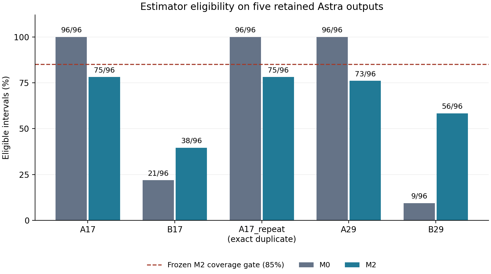

# Astra Action Consistency Evaluation

An independent study of measurement support in action-conditioned world-model evaluation.

**The original model-level result remains INCONCLUSIVE.** A revised image-motion estimator passed a bounded synthetic ground-truth suite, but every retained Astra output failed its frozen 85% coverage requirement. No physical camera-yaw fidelity result or Astra model defect has been established.

This is a **local publication candidate**, prepared on 2026-10-14. Public release is blocked pending completion reconciliation with the final analysis workflow and explicit publication approval. The finalized V2 records are available and their 27-file artifact inventory has been verified; that integrity check does not grant publication approval. See [publication blockers](PUBLICATION_BLOCKERS.md).

## Research question

With a fixed initial image, text prompt, model checkpoint and matched generation noise, do opposite camera-yaw commands yield distinguishable apparent background motion? Before using that observable to judge action fidelity, can the motion instrument supply reliable, sufficiently complete evidence?

The pilot used one scene, two seeds and five outputs, including an exact deterministic repeat. It is a small instrument-validity diagnostic. Image displacement alone cannot identify physical yaw in generated video without trustworthy correspondences, static-background assumptions and an appropriate geometric reference.

## Relationship to Astra

The model is **Astra: General Interactive World Model with Autoregressive Denoising**, by Zhu et al. This study uses the [official source](https://github.com/EternalEvan/Astra) pinned to [`3fb82e1939bfcf87d6e27a7da57d8b55ff9cb393`](https://github.com/EternalEvan/Astra/tree/3fb82e1939bfcf87d6e27a7da57d8b55ff9cb393).

The [accepted ICLR 2026 paper](https://proceedings.iclr.cc/paper_files/paper/2026/file/7fc516909e0b90c96bcc75a16ebee6a2-Paper-Conference.pdf) already reports command-aware human action-following judgments and a supplementary MegaSaM camera-pose comparison (Section 4.1 and Appendix A.4). Our image-motion and coverage analysis uses a different, much smaller design and guidance configuration. It does not replicate or refute those benchmark scores. The upstream repository supplies a 2025 arXiv citation; its verified BibTeX is in [references.bib](references.bib).

This project is independently conducted and is **not affiliated with, endorsed by, or an official implementation from the Astra authors**. Names and links above provide attribution.

## Evaluation methodology

- **M0:** frozen initial-landmark tracking in a prespecified image mask. Up to 200 Shi-Tomasi points are tracked by pyramidal Lucas-Kanade flow without reseeding. Forward/backward error must be at most 1 pixel. An interval needs at least 20 surviving tracks in at least four cells of a 4 x 4 image grid.
- **M1:** a historical synthetic comparator that refreshes tiled features every eight intervals.
- **M2:** features are detected independently for each adjacent frame pair in 16 tiles. Bidirectional flow and 7 x 7 patch NCC filters require forward/backward error at most 1 pixel and NCC at least 0.85. An interval requires at least 40 survivors in at least six grid cells and an acceptance fraction of at least 0.5.

The output is median horizontal image displacement, in pixels and divided by image width. A 0.25-pixel deadband defines descriptive direction. Invalid intervals are **abstentions**, never zero motion or directional failures. Every retained output has 97 decoded frames and 96 intervals; every interval stays in the coverage denominator. M2 video-level reporting additionally requires coverage at least 0.85 and within-video conditional direction agreement at least 0.90. This agreement is not agreement with physical truth.

The recipes change spatial selection, track lifecycle, photometric filtering and eligibility together. They do not isolate reseeding as the only cause of any difference. See [methodology](docs/METHODOLOGY.md) and the byte-preserved [frozen configuration](configs/synthetic_frozen.json).

## Bounded synthetic validation

The original CPU suite contained 13 cases on each of two deterministic scene instances: development seed 31017 and held-out seed 41029. Known rotational pinhole geometry supplies projection, visibility and photometric-support labels. Cases include both yaw signs, larger motion, zero motion, repeated and reversed sequences, occlusion, appearance attrition, blank frames and changing textures. Estimators receive images only; scoring uses geometric truth externally.

| Retained historical result | Development case gates | Held-out case gates | All declared selection gates |
| --- | ---: | ---: | --- |
| M0 | 6/13 | 6/13 | Failed; ineligible for replacement selection |
| M1 | 13/13 | 13/13 | Passed |
| M2 | 13/13 | 13/13 | Passed; selected by frozen priority |

M2 and M1 made no false-valid claims on the suite's truth-inadequate intervals. Ten independent geometry controls passed. These are findings for this fixed suite, not universal performance guarantees or a new state-of-the-art metric. The retained tables include failures and abstentions. Publication QA checks their arithmetic and runs a small numerical regression; it does not rerun the complete experiment.

## Real-video coverage limitations

Official checkpoint loading and the original five-video inference completed. Opposite-yaw conditioning, matched-noise and repeat controls passed. M0 showed severe asymmetric tracking attrition; M2 supplied more support for the B outputs while reducing A eligibility.

| Output | M0 eligible / 96 | M2 eligible / 96 | M2 coverage | M2 85% coverage gate |
| --- | ---: | ---: | ---: | --- |
| A17 | 96 | 75 | 78.12% | Failed |
| B17 | 21 | 38 | 39.58% | Failed |
| A17_repeat | 96 | 75 | 78.12% | Failed |
| A29 | 96 | 73 | 76.04% | Failed |
| B29 | 9 | 56 | 58.33% | Failed |



*Counts come from [astra_coverage.csv](results/astra_coverage.csv). The repeat is an exact duplicate rather than an independent replicate. The dashed line is the M2 reporting requirement. Coverage measures instrument eligibility; it does not measure action correctness. No confidence interval or population inference is implied.*

Condition-specific missingness prevents treating observed motion on each method's different accepted subsets as full-rollout action fidelity. Visibility/FOV loss, unreliable correspondences and generated appearance change remain unresolved possible contributors.

## Final annotation comparison and original conclusion

The finalized V2 analysis concerns AI-assisted coordinate proposals with user-reported visual review. The coordinates were not independently manually remeasured; there is no independent blinded human or geometric ground truth. Raw annotations, declarations and identities are excluded from this repository.

Using the preserved 3-pixel source-location linkage rule, M0 links 4/120 planned proposals and M2 links 28/120. On originally eligible intervals, the counts are 4/120 and 20/120. **Zero proposals link to both methods**, so there is no paired error comparison or relative-accuracy ranking. Subpixel agreement on separate supports is descriptive concordance with a related AI tracking procedure. It cannot establish correspondence correctness or physical yaw.

The original conclusion stays **INCONCLUSIVE**. Independent correctness, false-match rates and valid-match rejection rates are unavailable, not zero. See [scientific claims audit](SCIENTIFIC_CLAIMS_AUDIT.md).

**Final-window reconciliation placeholder:** finalized numerical records have been verified; confirmation that the concurrent final-analysis workflow has ended and release approval are still pending. No pending scientific numbers have been invented.

## Reproduce on CPU

Requires Python 3.11-3.13 with NumPy and headless OpenCV. The candidate was tested on Python 3.13.5, NumPy 2.1.3 and OpenCV 4.10.0. Historical suite versions are retained separately. No model checkpoint, private server, CUDA, PyTorch or API key is needed for these checks.

```bash
python -m venv .venv
```

Activate with `source .venv/bin/activate` on POSIX, or `.venv\Scripts\Activate.ps1` in PowerShell, then:

```bash
python -m pip install -r requirements.txt
python -m unittest discover -s tests -v
python tools/release_audit.py
python tools/release_audit.py --verify-manifest
```

Tests verify frozen source hashes, ten geometry controls, 24 retained M0/M2 interval records in a bounded synthetic smoke run, evidence-poor abstention, all 78 retained synthetic summaries and all 480 retained M2 real-video intervals. The original real videos are not re-evaluated during these tests.

Optional future CPU reproduction, writing only to new scratch directories:

```bash
python evaluation/synthetic.py --split heldout --case slow_positive --intervals 2 --output scratch/two-interval-check
python evaluation/synthetic.py --split all --case all --output scratch/full-synthetic-suite
```

The full command executes the synthetic suite; it was **not run during publication preparation**. Partial runs cannot reproduce its selection gate. Full reproduction also needs comparison with the saved summaries, repeat/reversal and overall false-valid gates; see [reproduction instructions](docs/REPRODUCING.md).

To recreate the figure, install `requirements-figures.txt` and run `python tools/plot_coverage.py --output scratch/figures`. Output directories must not already exist.

## Astra inference and data availability

Generating new Astra videos requires official model checkpoints, upstream dependencies, licensed conditioning assets and suitable GPU resources. None are distributed here, and no inference is launched by this repository's CPU tests. The [inference record](docs/ASTRA_INFERENCE.md) records settings and checkpoint provenance and explains the limits of exact reproduction. The original matched-noise inference wrapper and original scene media are withheld; this release reproduces the synthetic diagnostics and retained-result arithmetic, not the complete five-video generation from scratch.

With your own lawfully held native RGB frame array, `python evaluation/video.py frames.npy --output scratch/video-diagnostics.json` runs M0/M2 on CPU. The array must be uint8 with shape `[97,480,832,3]`. No silent resizing, new thresholds or physical-fidelity scoring is performed.

## License, provenance and release review

The MIT [license](LICENSE) applies to this project's original code, prose and original numeric/plot artifacts only. Upstream Astra code and documentation have a separately preserved [MIT notice](third_party/ASTRA_LICENSE.txt); this candidate does not bundle that implementation. No license is inferred for checkpoints or third-party media. Dependencies keep their own licenses and are installed separately.

File-level origins, transformations and SHA-256 hashes are recorded in [provenance](provenance/sources.json) and [public inventory](PUBLIC_FILE_INVENTORY.md). See [license/privacy audit](LICENSE_AND_PRIVACY_AUDIT.md), [reproducibility check](REPRODUCIBILITY_CHECK.md), and [readiness report](PUBLICATION_READINESS_REPORT.md). [Publication commands](docs/PUBLICATION_COMMANDS.md) are review-only and have not been executed.
